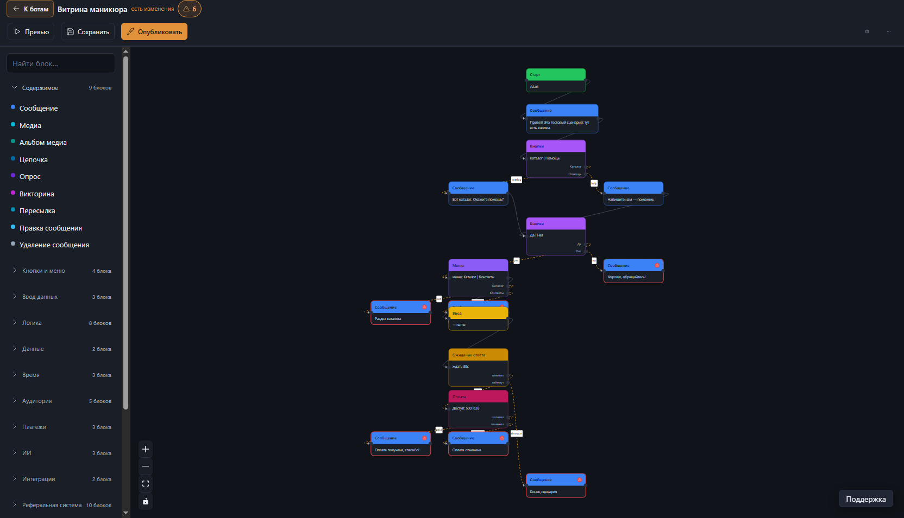
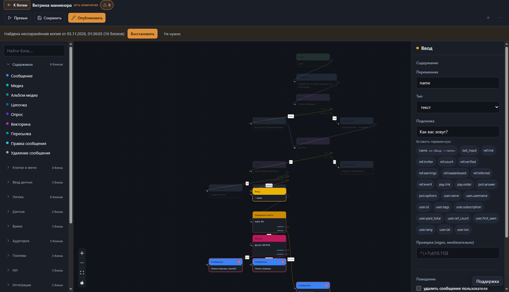

# Конструктор ботов — no-code платформа для Telegram и VK

Визуальный редактор, в котором бота собирают из блоков на холсте
(drag-and-drop), проверяют прогоном в браузере и публикают в один клик.
Платформа сама держит вебхук на Cloudflare Workers, хранит версии сценариев
в D1 и состояние диалога в D1/KV.





**Стек:** Cloudflare Workers (Hono) · D1 · KV · React + Vite + @xyflow/react ·
vitest (103 файла, 1594 теста) · TypeScript без `any`-стиля в новых модулях.

> Проект личный, статус — «работает в проде у одного владельца». Мини-аппы
> (Telegram WebApp) в разработке и скрыты за флагом `MINI_APPS_ENABLED`.

## Возможности

- **Холст сценария** — 55 типов блоков в 13 группах палитры, инспектор
  параметров, подсценарии (фрагменты из библиотеки, раскрытие при
  публикации), двойной клик по вызову открывает фрагмент.
- **Превью без публикации** — серверный прогон настоящего `runEngine`
  с вводом текста, кнопок, платежей и таймеров.
- **Две платформы** — Telegram (Bot API + Payments) и VK (Callback API v2,
  адаптер исходящих `worker/src/vk.ts`, единый движок на обе платформы,
  TG-only блоки скрыты матрицей `shared/platform.ts`).
- **Платежи** — владелец бота подключает СВОЕГО провайдера
  (BotFather Payments / ЮKassa / Robokassa / Stripe / custom): платформа
  не проксирует деньги и не видит карты. Секреты шифруются AES-256-GCM,
  вебхук идемпотентен, replay-окно 5 минут.
- **Рассылки и расписание** — daily/weekly/interval/cron, часовой пояс IANA,
  до 20 расписаний на бота, защита от двойного срабатывания.
- **ИИ-блоки** — `ai` с памятью диалога (история в переменной или таблице
  бота), `ai_classify` с резервной веткой, `random_text`.
- **Данные** — коллекции бота (таблицы, формы, фильтры, поиск, экспорт),
  теги, сегменты, статистика по пользователям.
- **История версий** — сценарий версионируется при сохранении, откат любой
  версии, оптимистичная блокировка при конфликте (409).
- **RU/EN интерфейс**, тёмная и светлая темы, мобильная вёрстка.

## Структура

```
shared/      types.ts (55 типов блоков) · validate.ts (валидатор — один код
             для фронта и воркера) · graph.ts · markup.ts · expr.ts ·
             limits.ts (вместимость — единый источник чисел) · cron.ts ·
             subflow.ts · platform.ts (матрица Telegram/VK) · miniapp*
worker/      CF Worker (Hono): вебхуки TG и VK, админ-API, крон, движок
  src/index.ts    роуты + вебхуки + крон (отложенные отправки, рассылки)
  src/engine.ts   интерпретатор сценария (чистая функция, ops-интерфейсы)
  src/db.ts       все SQL-запросы (только биндинги параметров)
  src/auth.ts     PBKDF2-пароли и сессии (100k итераций — потолок Workers)
  src/crypto.ts   AES-256-GCM для токенов ботов и платёжных секретов
  src/blocks/     рантаймы блоков: payments, referral, quiz, lang, ...
  src/miniapp/    рантайм мини-аппов (SPA, initData-HMAC, Stars)
  src/vk.ts       адаптер платформы VK
  migrations/     0001…0031
web/         React + Vite: Constructor.tsx (холст), Inspector.tsx, страницы
             данных/платежей/поддержки/админки, i18n (~1500 ключей RU/EN)
tests/       vitest, 103 файла: движок, валидатор, платежи, VK, крон, ...
docs/        CODEBASE.md — архитектура; RUNBOOK провайдеров — в шапке
             worker/migrations/0018_payments.sql
```

Подробный разбор архитектуры — [docs/CODEBASE.md](docs/CODEBASE.md).

## Блоки

55 типов, палитра разбита на группы: **Содержимое** (message, media,
media_group, poll, quiz, forward, edit_message, delete_message), **Кнопки
и меню**, **Ввод данных** (текст/число/email/фото/гео/что угодно),
**Логика** (condition, switch, foreach, keyword, assert, language),
**Время** (schedule, wait, timer_deadline), **Аудитория**, **Платежи**
(invoice, payment_link, payment_check), **ИИ**, **Интеграции** (http,
webhook_in, action), **Реферальная система**, **Поток** (start, command,
goto, subflow, ...).

Из интересного:

- `wait` — ветки `reply`/`timeout`, таймер живёт в `scheduled_sends` и
  обрабатывается кроном воркера.
- «Ввод» с проверкой формата: `kind` число/e-mail отклоняет неверный ответ
  и переспрашивает (текст переспроса настраивается), сверху можно наложить
  свою regex-проверку с защитой от ReDoS.
- `foreach` — реентерабельный цикл: недопройденный цикл доезжает фоново,
  движок не считает его зацикливанием.
- `subflow` — вызов фрагмента библиотеки; при публикации РАСКРЫВАЕТСЯ в
  обычные блоки, движок подсценариев не знает.
- Текстовые блоки поддерживают `parseMode` (HTML/MarkdownV2): `{{var}}`
  экранируется, `{{{var}}}` вставляется сырым.
- Справочник блоков в гайдах конструктора ГЕНЕРИРУЕТСЯ из реестра
  `web/src/blocks.ts`; `tests/registry.test.ts` не даёт забыть подпись и
  текст в обоих языках.

## Локальный запуск

```bash
# Тесты движка (из корня)
npm install && npm test

# 1. Worker
cd worker
npm install
cp wrangler.example.toml wrangler.toml   # реальный конфиг не коммитится
wrangler d1 create bots_constructor      # один раз; id вписать в wrangler.toml
wrangler kv namespace create WEBHOOK_SECRETS
wrangler secret put ENCRYPTION_KEY       # base64 от 32 случайных байт
wrangler secret put ADMIN_KEY            # админ-доступ; без него доступ закрыт
npm run migrate:local
npm run dev                              # http://localhost:8787

# 2. Frontend
cd ../web
npm install
cp .env.production.example .env          # при необходимости поправить
npm run dev                              # http://localhost:5173 (проксирует /api -> :8787)
```

`ADMIN_KEY` fail-closed во всех окружениях: без заданного ключа админ-доступа
нет нигде, включая локальную разработку. Локально задавайте свой ключ:
`wrangler dev --var ADMIN_KEY:<локальный ключ>` (формат `KEY:VALUE`, двоеточие).

## Деплой

```bash
cd worker
cp wrangler.example.toml wrangler.toml    # если ещё не сделано
# вписать свои account_id / database_id / KV id
npm install
wrangler secret put ENCRYPTION_KEY
wrangler secret put ADMIN_KEY
npm run migrate:remote
wrangler deploy

cd ../web
cp .env.production.example .env.production   # вписать адрес своего воркера
npm run build          # VITE_API_BASE берётся из .env.production
wrangler pages deploy dist --project-name=bots-constructor-web --branch=main
# --branch=main ОБЯЗАТЕЛЕН: без него деплой уходит в preview
```

Реальные `wrangler.toml` и `web/.env.production` в git не живут (только
example-шаблоны) — вписывай свои id и адреса в локальные копии.

Публикация бота делается из интерфейса («Публикация»): валидация сценария →
сохранение версии → `setWebhook` с `secret_token` → `setMyCommands`.
Проверка секрета вебхука идёт до любого обращения к D1.

## Безопасность

- Токены ботов шифруются AES-256-GCM и не возвращаются ни одним эндпоинтом.
- Секрет вебхука проверяется до D1; все SQL — с биндингами.
- CORS — белый список origin'ов, не `*`.
- Внешние вызовы блоков `http`/`action.webhook` идут через `safeFetch`
  (таймаут, лимит ответа, SSRF-гарды приватных диапазонов).
- Антибрут на `/api/auth/*`, частотные лимиты на дорогие пути
  (simulate 30/мин, publish 10/мин, 429 + Retry-After).
- Тело вебхука ограничено 1 МБ (превышение — 200 ack без разбора).
- Пароли — PBKDF2 100k итераций; есть смена пароля и «выйти на всех
  устройствах».

## Вместимость

Единый источник чисел — `shared/limits.ts` (движок, D1, валидатор и доки
читают его, а не хардкодят):

| Ограничение | Значение | Что на пределе |
|---|---|---|
| Шагов движка за проход | 1000 | остаток потока продолжается фоново |
| Итераций foreach | до 1000 | недопройденный цикл доезжает фоново |
| Поиск в коллекциях | 5000 строк скана | частичный поиск + лог |
| Расписаний на бота | 20 | регистрация отклоняется |
| Получателей расписания за тик | 2000 | остаток ждёт следующий тик |
| callback_data кнопки | 64 байта | ошибка валидации, публикация блокируется |

## Известное

- В коде осталось много `: any` — чистится точечно по ходу правок.
- Расписания `interval` с периодом, не кратным 60, считаются от
  `last_run_at`: срабатывание может отставать до минуты.
- `schedule_run` обрабатывает получателей последовательно; аудитория,
  близкая к 2000, занимает заметную часть минутного бюджета крона.

## Лицензия

MIT — код открыт, можно использовать и модифицировать с сохранением
уведомления о лицензии. Подробности — [LICENSE](LICENSE).
